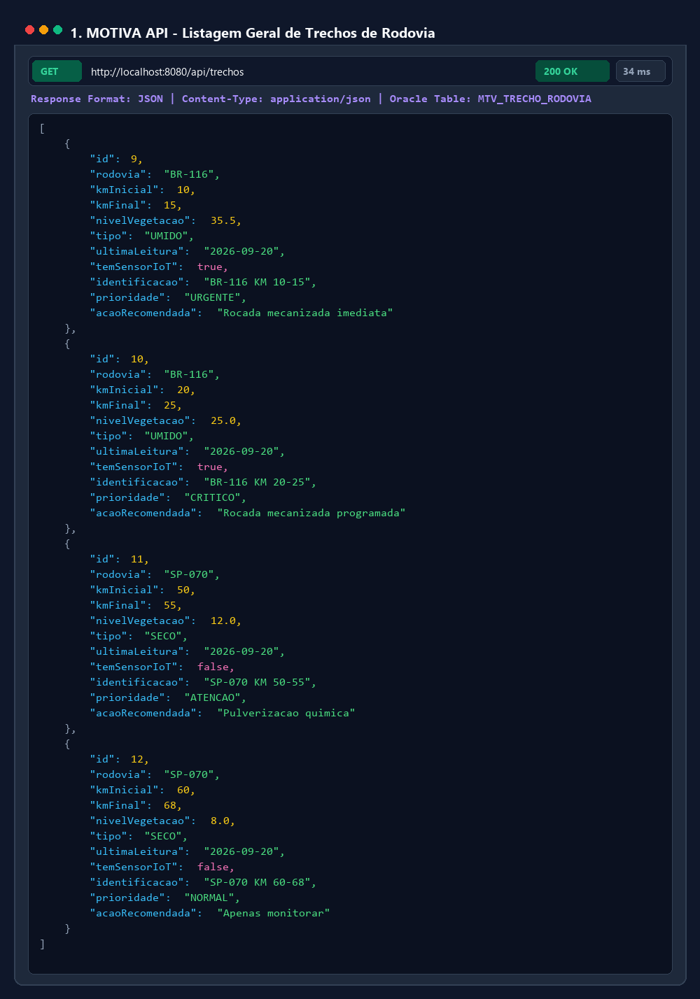
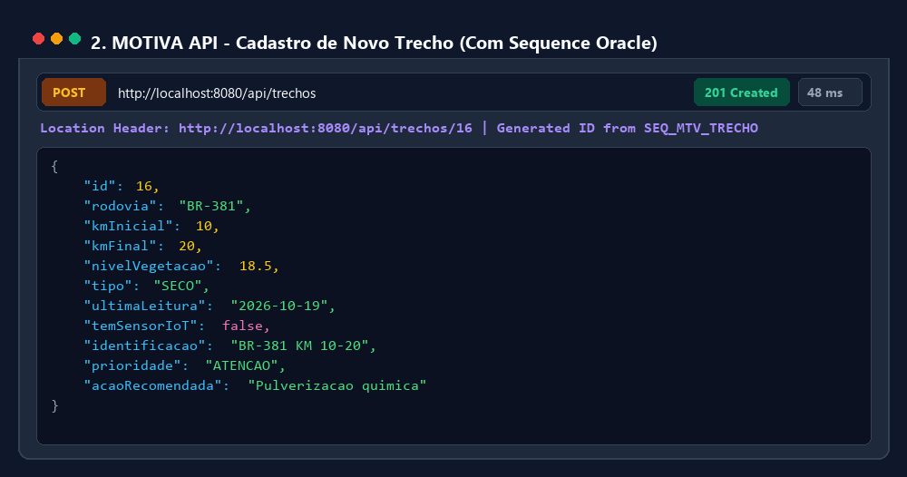
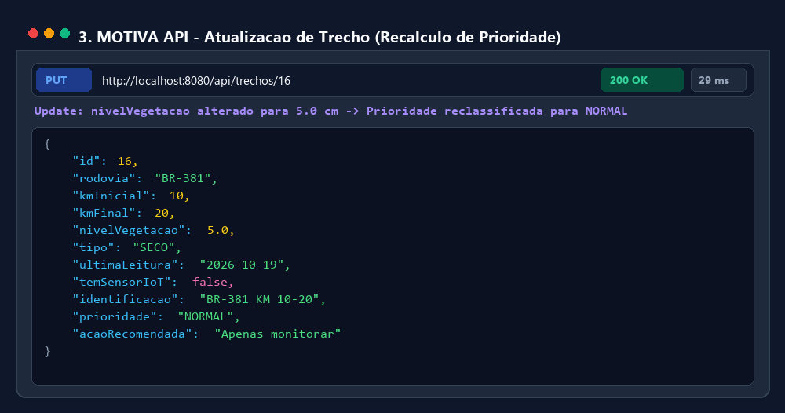
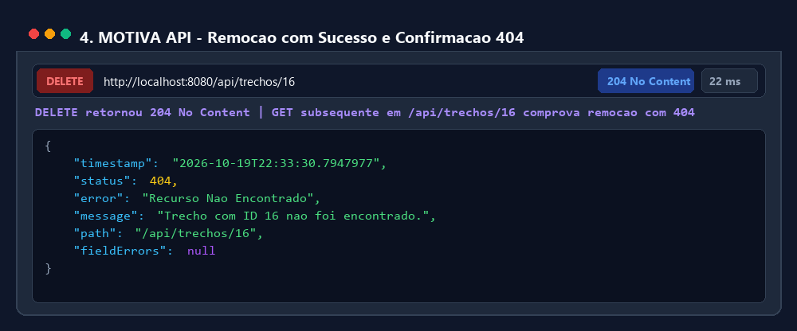
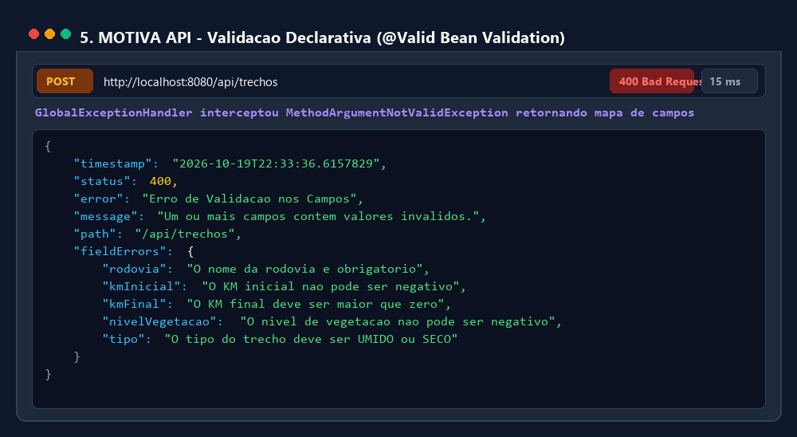
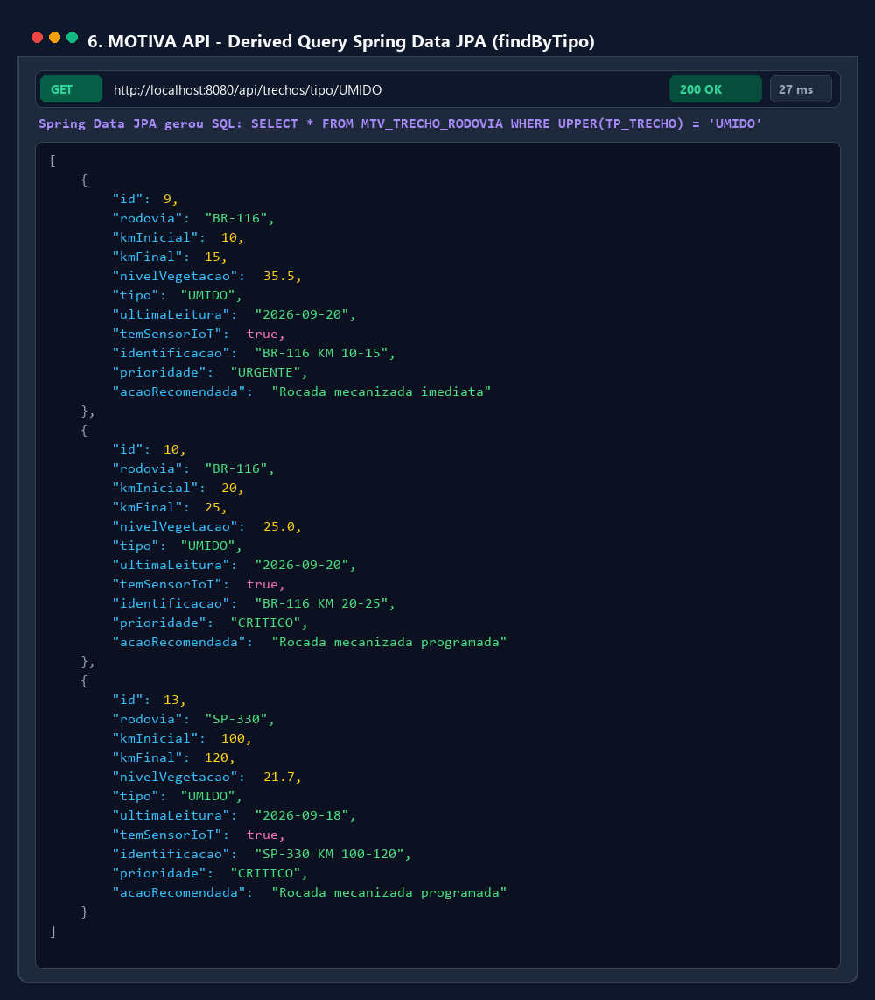
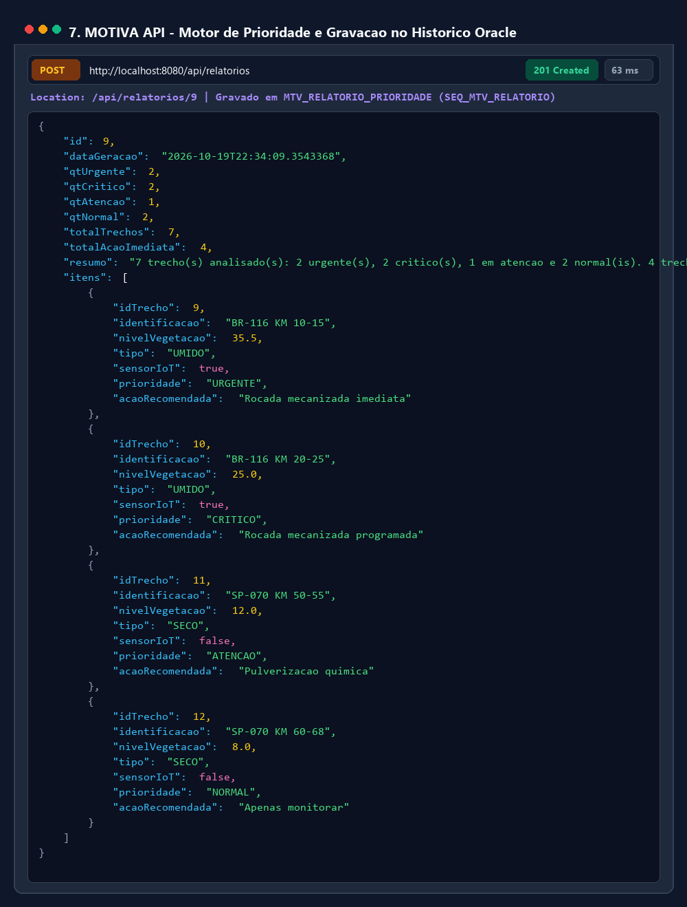

# MOTIVA — Gestão Inteligente de Vegetação em Faixa de Domínio Rodoviária
## Sprint 4 — Migração para Spring Boot + Spring Data JPA + API REST

[](https://www.oracle.com/java/)
[](https://spring.io/projects/spring-boot)
[](https://spring.io/projects/spring-data-jpa)
[](https://www.oracle.com/database/)
[](https://maven.apache.org/)
[](https://junit.org/)

---

## 1. Visão Geral e Contexto da Sprint 4

A **Sprint 4** representa a grande virada tecnológica do projeto **MOTIVA** (GreenAV). O sistema, que até a Sprint 3 operava como um protótipo de console com persistência via JDBC puro manual, foi transformado em uma **API REST profissional**, moderna e escalável, utilizando **Spring Boot 4.1.x**, **Spring Data JPA** e **Bean Validation**, reutilizando o banco de dados Oracle da FIAP e todas as tabelas e sequences modeladas nas sprints anteriores.

### Evolução do Sistema através das Sprints

| Sprint | Foco Pedagógico | O que foi construído |
|---|---|---|
| **Sprint 1** | **Domínio Base & Encapsulamento** | `TrechoRodovia`, atributos privados, validações de integridade, protótipo em console |
| **Sprint 2** | **Polimorfismo & Motor de Regras** | Classes abstratas (`IntervencaoOperacional`), subclasses concretas (`RocadaMecanizada`, `Pulverizacao`), interfaces (`MonitoravelViaIoT`), `TrechoUmido`, `TrechoSeco`, motor de prioridade |
| **Sprint 3** | **Persistência Relacional (JDBC Puro)** | Padrão DAO (`EquipeManutencaoDAO`, `TrechoRodoviaDAO`, etc.), scripts SQL no Oracle FIAP, pool/singleton manual (`ConexaoBD`), histórico de relatórios |
| **Sprint 4** | **Framework Spring Boot + JPA + REST** | **Entidades JPA (`@Entity`), Repositories gerados via Dynamic Proxy, Camada de Serviços (`@Service`), Endpoints REST (`@RestController`), DTOs, Bean Validation, `@ControllerAdvice` e Testes Automatizados com MockMvc** |

---

## 2. A Grande Virada: De DAO JDBC para Camadas Spring

```
+------------------------------------+---------------------------------------+
|        Sprint 3 (JDBC Puro)        |       Sprint 4 (Spring Boot + JPA)    |
+------------------------------------+---------------------------------------+
| model/ + record interno do DAO     | @Entity mapeado para tabelas Oracle   |
| EquipeManutencaoDAO (~375 linhas)  | EquipeRepository (interface, ~5 linhas) |
| ConexaoBD (Singleton manual)       | application.properties + HikariCP     |
| service/GeradorRelatorio           | @Service (regras de negócio isoladas) |
| Main.main() com System.out.println | @RestController com respostas JSON    |
| Teste manual no console            | Testes automatizados (MockMvc + cURL) |
+------------------------------------+---------------------------------------+
```

> **Mensagem pedagógica da Aula 13:**
> ```java
> // Sprint 3 (JDBC puro): ~40 linhas por operação
> Connection conn = DriverManager.getConnection(...);
> PreparedStatement stmt = conn.prepareStatement("INSERT INTO ...");
> // ... set parâmetros, execute, try/catch, fechar tudo no finally ...
>
> // Sprint 4 (Spring Data JPA): 1 linha declarativa
> repository.save(trecho);
> ```

---

## 3. Arquitetura em Camadas

O projeto obedece estritamente à arquitetura em camadas solicitada, garantindo que cada camada converse exclusivamente com sua vizinha:
$$\text{Controller} \longrightarrow \text{Service} \longrightarrow \text{Repository} \longrightarrow \text{Banco Oracle}$$

```
src/
├── main/
│   ├── java/br/com/motiva/
│   │   ├── MotivaApplication.java           # Classe principal com @SpringBootApplication
│   │   │
│   │   ├── model/                           # Entidades JPA (@Entity)
│   │   │   ├── MonitoravelViaIoT.java       # Interface da Sprint 2
│   │   │   ├── Trecho.java                  # Mapeia MTV_TRECHO_RODOVIA (SEQ_MTV_TRECHO)
│   │   │   ├── Equipe.java                  # Mapeia MTV_EQUIPE_MANUTENCAO (SEQ_MTV_EQUIPE)
│   │   │   ├── Intervencao.java             # Mapeia MTV_INTERVENCAO_OPERACIONAL (SEQ_MTV_INTERVENCAO)
│   │   │   └── RelatorioPrioridade.java     # Mapeia MTV_RELATORIO_PRIORIDADE (SEQ_MTV_RELATORIO)
│   │   │
│   │   ├── repository/                      # Interfaces Spring Data JPA (SEM SQL manual)
│   │   │   ├── TrechoRepository.java        # Derived queries (findByNivelVegetacaoGreaterThanEqual, etc.)
│   │   │   ├── EquipeRepository.java        # Derived queries (findByTurno, findByAtiva, etc.)
│   │   │   ├── IntervencaoRepository.java   # Derived queries (findByTrechoId, findByTipo, etc.)
│   │   │   └── RelatorioPrioridadeRepository.java # Derived queries (findByDataGeracaoBetween, etc.)
│   │   │
│   │   ├── service/                         # Regras de negócio e motor de prioridade
│   │   │   ├── TrechoService.java           # Validações Sprint 1 + classificação de prioridade
│   │   │   ├── EquipeService.java           # Regras operacionais de equipes
│   │   │   ├── IntervencaoService.java      # Atualização do trecho pós-intervenção (Sprint 2)
│   │   │   └── RelatorioService.java        # Motor do antigo GeradorRelatorio persistindo no histórico
│   │   │
│   │   ├── controller/                      # Endpoints da API REST (@RestController)
│   │   │   ├── TrechoController.java        # /api/trechos (CRUD + filtros)
│   │   │   ├── EquipeController.java        # /api/equipes (CRUD + filtros)
│   │   │   ├── IntervencaoController.java   # /api/intervencoes (CRUD + histórico)
│   │   │   └── RelatorioController.java     # /api/relatorios (geração + histórico + período)
│   │   │
│   │   ├── dto/                             # Contratos da API (Records com Bean Validation)
│   │   │   ├── TrechoRequestDTO.java
│   │   │   ├── TrechoResponseDTO.java
│   │   │   ├── EquipeRequestDTO.java
│   │   │   ├── EquipeResponseDTO.java
│   │   │   ├── IntervencaoRequestDTO.java
│   │   │   ├── IntervencaoResponseDTO.java
│   │   │   ├── RelatorioItemDTO.java
│   │   │   ├── RelatorioResponseDTO.java
│   │   │   └── ErrorResponseDTO.java
│   │   │
│   │   └── exception/                       # Tratamento global de erros (@RestControllerAdvice)
│   │       ├── GlobalExceptionHandler.java  # Mapeia exceções para 400, 404, 500
│   │       ├── ResourceNotFoundException.java # 404 Not Found
│   │       └── BusinessException.java       # 400 Bad Request
│   │
│   └── resources/
│       ├── application.properties           # Configuração de conexão Oracle FIAP
│       └── application-test.properties      # Configuração para testes com H2
│
├── test/
│   ├── java/br/com/motiva/
│   │   ├── MotivaApplicationTests.java      # Teste de subida do contexto
│   │   ├── service/
│   │   │   └── TrechoServiceTest.java       # Testes unitários das regras da Sprint 1 e 2
│   │   └── controller/
│   │       ├── TrechoControllerTest.java    # Testes MockMvc do CRUD de trechos
│   │       ├── EquipeControllerTest.java    # Testes MockMvc do CRUD de equipes
│   │       ├── IntervencaoControllerTest.java # Testes MockMvc de intervenções
│   │       └── RelatorioControllerTest.java # Testes MockMvc do motor de relatório
│   └── resources/
│       └── application.properties           # Perfil H2 em memória
│
├── sql/
│   ├── script-criacao.sql                   # DDL das tabelas, sequences e triggers Oracle
│   └── script-dados.sql                     # Carga de dados de teste
├── pom.xml                                  # Configurações do Maven e dependências
├── .gitignore                               # Ignora target/, *.class, config.local.bat
├── config.local.exemplo.bat                 # Modelo de credenciais locais
└── executar.bat                             # Script de execução rápida
```

---

## 4. Tabela de Endpoints da API REST

A API foi projetada segundo os princípios RESTful, retornando os códigos HTTP corretos:
- `200 OK`: Consulta ou atualização bem-sucedida.
- `201 Created`: Criação de recurso com cabeçalho `Location` apontando para a URI do recurso criado.
- `204 No Content`: Remoção bem-sucedida (sem corpo).
- `400 Bad Request`: Falha de validação de campo ou violação de regra de negócio.
- `404 Not Found`: Recurso não localizado no banco de dados.

### 4.1 Trechos de Rodovia (`/api/trechos`)

| Método | Rota | Descrição | Retorno Sucesso | Erro |
|---|---|---|---|---|
| `GET` | `/api/trechos` | Lista todos os trechos cadastrados | `200 OK` | `500` |
| `GET` | `/api/trechos/{id}` | Busca um trecho específico por ID | `200 OK` | `404` |
| `POST` | `/api/trechos` | Cria um novo trecho de rodovia | `201 Created` + `Location` | `400` |
| `PUT` | `/api/trechos/{id}` | Atualiza dados de um trecho existente | `200 OK` | `400`, `404` |
| `DELETE` | `/api/trechos/{id}` | Remove um trecho pelo ID | `204 No Content` | `404` |
| `GET` | `/api/trechos/tipo/{tipo}` | Consulta trechos por tipo (`UMIDO` ou `SECO`) *(Derived Query)* | `200 OK` | `500` |
| `GET` | `/api/trechos/vegetacao-minima?minimo=X` | Filtra trechos com vegetação $\ge X$ cm *(Derived Query)* | `200 OK` | `400` |

### 4.2 Equipes de Manutenção (`/api/equipes`)

| Método | Rota | Descrição | Retorno Sucesso | Erro |
|---|---|---|---|---|
| `GET` | `/api/equipes` | Lista todas as equipes de manutenção | `200 OK` | `500` |
| `GET` | `/api/equipes/{id}` | Busca equipe por ID | `200 OK` | `404` |
| `POST` | `/api/equipes` | Cadastra nova equipe de campo | `201 Created` + `Location` | `400` |
| `PUT` | `/api/equipes/{id}` | Atualiza informações da equipe | `200 OK` | `400`, `404` |
| `DELETE` | `/api/equipes/{id}` | Remove uma equipe | `204 No Content` | `404` |
| `GET` | `/api/equipes/turno/{turno}` | Consulta equipes por turno (`MANHA`, `TARDE`, `NOITE`) | `200 OK` | `500` |
| `GET` | `/api/equipes/ativas` | Lista apenas equipes em atividade (`ST_ATIVA = 'S'`) | `200 OK` | `500` |

### 4.3 Intervenções Operacionais (`/api/intervencoes`)

| Método | Rota | Descrição | Retorno Sucesso | Erro |
|---|---|---|---|---|
| `GET` | `/api/intervencoes` | Lista todo o histórico de serviços executados | `200 OK` | `500` |
| `GET` | `/api/intervencoes/{id}` | Busca intervenção por ID | `200 OK` | `404` |
| `POST` | `/api/intervencoes` | Registra intervenção e atualiza vegetação do trecho | `201 Created` + `Location` | `400`, `404` |
| `PUT` | `/api/intervencoes/{id}` | Atualiza dados da intervenção | `200 OK` | `400`, `404` |
| `DELETE` | `/api/intervencoes/{id}` | Remove registro de intervenção | `204 No Content` | `404` |
| `GET` | `/api/intervencoes/tipo/{tipo}` | Filtra por tipo (`ROCADA_MECANIZADA` / `PULVERIZACAO`) | `200 OK` | `500` |
| `GET` | `/api/intervencoes/trecho/{trechoId}` | Histórico de intervenções de um trecho | `200 OK` | `500` |

### 4.4 Relatório de Prioridade de Manutenção (`/api/relatorios`)

| Método | Rota | Descrição | Retorno Sucesso | Erro |
|---|---|---|---|---|
| `POST` | `/api/relatorios` | Executa o motor de regras, classifica os trechos e persiste no histórico | `201 Created` + `Location` | `500` |
| `GET` | `/api/relatorios` | Lista todo o histórico de relatórios gerados | `200 OK` | `500` |
| `GET` | `/api/relatorios/{id}` | Detalhes de um relatório específico do histórico | `200 OK` | `404` |
| `GET` | `/api/relatorios/periodo?inicio=...&fim=...` | Consulta relatórios gerados em um intervalo de datas | `200 OK` | `400` |

---

## 5. Regras de Negócio e Motor de Prioridade

A classificação de prioridade de manutenção é executada pelo `TrechoService` e `RelatorioService` a partir do nível de vegetação (em centímetros):

$$\text{Classificação} = \begin{cases}
\textbf{URGENTE} & \text{se } \text{nível} \ge 30.0\text{ cm} \longrightarrow \text{Ação: Roçada mecanizada imediata} \\
\textbf{CRÍTICO} & \text{se } 20.0 \le \text{nível} < 30.0\text{ cm} \longrightarrow \text{Ação: Roçada mecanizada programada} \\
\textbf{ATENÇÃO} & \text{se } 10.0 \le \text{nível} < 20.0\text{ cm} \longrightarrow \text{Ação: Pulverização química} \\
\textbf{NORMAL}  & \text{se } \text{nível} < 10.0\text{ cm} \longrightarrow \text{Ação: Apenas monitorar}
\end{cases}$$

### Regras Operacionais Herdadas das Sprints 1 e 2:
1. **Trecho Úmido (`TP_TRECHO = 'UMIDO'`)**: Implementa a interface `MonitoravelViaIoT` e simula a leitura via telemetria (`transmitirDadosSensor()`). Sua taxa de crescimento vegetal é o dobro de um trecho comum ($2.0\times$).
2. **Trecho Seco (`TP_TRECHO = 'SECO'`)**: Não possui sensor IoT e sua taxa de crescimento vegetal é reduzida à metade ($0.5\times$).
3. **Execução de Intervenção (`IntervencaoService`)**: Ao registrar uma intervenção (`POST /api/intervencoes`), o serviço automaticamente atualiza o nível da vegetação do trecho correspondente para o valor de `nivelDepois` e atualiza a data da última leitura.

---

## 6. Como Executar a Aplicação

### Pré-requisitos
- **Java 17 LTS** instalado e configurado no `PATH`.
- **Maven 3.9+** (ou utilizar o Maven disponível no ambiente).
- Acesso à internet para conexão com o Oracle FIAP (`oracle.fiap.com.br:1521:ORCL`).

### Passo 1: Configuração das Credenciais do Oracle
Por segurança, senhas reais **não** são commitadas no repositório. O projeto utiliza variáveis de ambiente ou o arquivo `config.local.bat` (ignorado pelo `.gitignore`):

1. Copie o arquivo modelo:
   ```cmd
   copy config.local.exemplo.bat config.local.bat
   ```
2. Abra `config.local.bat` e certifique-se de que o seu RM e senha estão preenchidos:
   ```bat
   set ORACLE_URL=jdbc:oracle:thin:@oracle.fiap.com.br:1521:ORCL
   set ORACLE_USER=rm565994
   set ORACLE_PASSWORD=sua_senha_aqui
   ```

### Passo 2: Inicializar a Aplicação
Execute o script em lote fornecido:
```cmd
executar.bat
```
Ou diretamente pelo Maven no terminal:
```cmd
mvn spring-boot:run
```

A aplicação inicializará o Tomcat embutido na porta `8080`:
```
Started MotivaApplication in 3.762 seconds (process running for 4.107)
Tomcat started on port 8080 (http) with context path '/'
```

### Passo 3: Executar a Suíte de Testes Automatizados
Para rodar todos os 24 testes unitários e de integração (MockMvc + SpringBootTest) usando o banco isolado em memória (H2):
```cmd
testar.bat
```
Ou via Maven:
```cmd
mvn test
```

---

## 7. Registros de Requisições da API (Testes Reais com cURL)

Abaixo estão registrados exemplos reais de requisições executadas contra a API rodando com Spring Boot conectado ao banco Oracle da FIAP.

### Requisição 1: Listar Todos os Trechos (CRUD - Read)



```bash
curl -X GET http://localhost:8080/api/trechos
```
**Resposta (HTTP 200 OK):**
```json
[
  {
    "id": 9,
    "rodovia": "BR-116",
    "kmInicial": 10,
    "kmFinal": 15,
    "nivelVegetacao": 35.5,
    "tipo": "UMIDO",
    "ultimaLeitura": "2026-09-20",
    "temSensorIoT": true,
    "identificacao": "BR-116 KM 10-15",
    "prioridade": "URGENTE",
    "acaoRecomendada": "Rocada mecanizada imediata"
  },
  {
    "id": 10,
    "rodovia": "BR-116",
    "kmInicial": 20,
    "kmFinal": 25,
    "nivelVegetacao": 25.0,
    "tipo": "UMIDO",
    "ultimaLeitura": "2026-09-20",
    "temSensorIoT": true,
    "identificacao": "BR-116 KM 20-25",
    "prioridade": "CRITICO",
    "acaoRecomendada": "Rocada mecanizada programada"
  },
  {
    "id": 11,
    "rodovia": "SP-070",
    "kmInicial": 50,
    "kmFinal": 55,
    "nivelVegetacao": 12.0,
    "tipo": "SECO",
    "ultimaLeitura": "2026-09-20",
    "temSensorIoT": false,
    "identificacao": "SP-070 KM 50-55",
    "prioridade": "ATENCAO",
    "acaoRecomendada": "Pulverizacao quimica"
  },
  {
    "id": 12,
    "rodovia": "SP-070",
    "kmInicial": 60,
    "kmFinal": 68,
    "nivelVegetacao": 8.0,
    "tipo": "SECO",
    "ultimaLeitura": "2026-09-20",
    "temSensorIoT": false,
    "identificacao": "SP-070 KM 60-68",
    "prioridade": "NORMAL",
    "acaoRecomendada": "Apenas monitorar"
  }
]
```

---

### Requisição 2: Criar Novo Trecho (CRUD - Create)



```bash
curl -i -X POST http://localhost:8080/api/trechos \
  -H "Content-Type: application/json" \
  -d '{
    "rodovia": "BR-381",
    "kmInicial": 10,
    "kmFinal": 20,
    "nivelVegetacao": 18.5,
    "tipo": "SECO"
  }'
```
**Resposta (HTTP 201 Created):**
```http
HTTP/1.1 201 
Location: http://localhost:8080/api/trechos/16
Content-Type: application/json

{
  "id": 16,
  "rodovia": "BR-381",
  "kmInicial": 10,
  "kmFinal": 20,
  "nivelVegetacao": 18.5,
  "tipo": "SECO",
  "ultimaLeitura": "2026-10-19",
  "temSensorIoT": false,
  "identificacao": "BR-381 KM 10-20",
  "prioridade": "ATENCAO",
  "acaoRecomendada": "Pulverizacao quimica"
}
```

---

### Requisição 3: Atualizar Trecho Existente (CRUD - Update)



```bash
curl -i -X PUT http://localhost:8080/api/trechos/16 \
  -H "Content-Type: application/json" \
  -d '{
    "rodovia": "BR-381",
    "kmInicial": 10,
    "kmFinal": 20,
    "nivelVegetacao": 5.0,
    "tipo": "SECO"
  }'
```
**Resposta (HTTP 200 OK):**
```http
HTTP/1.1 200 
Content-Type: application/json

{
  "id": 16,
  "rodovia": "BR-381",
  "kmInicial": 10,
  "kmFinal": 20,
  "nivelVegetacao": 5.0,
  "tipo": "SECO",
  "ultimaLeitura": "2026-10-19",
  "temSensorIoT": false,
  "identificacao": "BR-381 KM 10-20",
  "prioridade": "NORMAL",
  "acaoRecomendada": "Apenas monitorar"
}
```

---

### Requisição 4: Remover Trecho (CRUD - Delete)



```bash
curl -i -X DELETE http://localhost:8080/api/trechos/16
```
**Resposta (HTTP 204 No Content):**
```http
HTTP/1.1 204 
Date: Tue, 20 Oct 2026 01:33:24 GMT
```

Consulta subsequente ao mesmo ID:
```bash
curl -i -X GET http://localhost:8080/api/trechos/16
```
**Resposta (HTTP 404 Not Found):**
```json
{
  "timestamp": "2026-10-19T22:33:30.7947977",
  "status": 404,
  "error": "Recurso Nao Encontrado",
  "message": "Trecho com ID 16 nao foi encontrado.",
  "path": "/api/trechos/16",
  "fieldErrors": null
}
```

---

### Requisição 5: Teste de Validação Global (@Valid + Bean Validation)



```bash
curl -i -X POST http://localhost:8080/api/trechos \
  -H "Content-Type: application/json" \
  -d '{
    "rodovia": "",
    "kmInicial": -5,
    "kmFinal": 0,
    "nivelVegetacao": -10,
    "tipo": "INVALIDO"
  }'
```
**Resposta (HTTP 400 Bad Request):**
```json
{
  "timestamp": "2026-10-19T22:33:36.6157829",
  "status": 400,
  "error": "Erro de Validacao nos Campos",
  "message": "Um ou mais campos contem valores invalidos.",
  "path": "/api/trechos",
  "fieldErrors": {
    "kmInicial": "O KM inicial nao pode ser negativo",
    "kmFinal": "O KM final deve ser maior que zero",
    "nivelVegetacao": "O nivel de vegetacao nao pode ser negativo",
    "rodovia": "O nome da rodovia e obrigatorio",
    "tipo": "O tipo do trecho deve ser UMIDO ou SECO"
  }
}
```

---

### Requisição 6: Filtrar Trechos por Derived Query (`findByTipo`)



```bash
curl -X GET http://localhost:8080/api/trechos/tipo/UMIDO
```
**Resposta (HTTP 200 OK):**
```json
[
  {
    "id": 9,
    "rodovia": "BR-116",
    "kmInicial": 10,
    "kmFinal": 15,
    "nivelVegetacao": 35.5,
    "tipo": "UMIDO",
    "ultimaLeitura": "2026-09-20",
    "temSensorIoT": true,
    "identificacao": "BR-116 KM 10-15",
    "prioridade": "URGENTE",
    "acaoRecomendada": "Rocada mecanizada imediata"
  },
  {
    "id": 10,
    "rodovia": "BR-116",
    "kmInicial": 20,
    "kmFinal": 25,
    "nivelVegetacao": 25.0,
    "tipo": "UMIDO",
    "ultimaLeitura": "2026-09-20",
    "temSensorIoT": true,
    "identificacao": "BR-116 KM 20-25",
    "prioridade": "CRITICO",
    "acaoRecomendada": "Rocada mecanizada programada"
  }
]
```

---

### Requisição 7: Gerar Relatório de Prioridade e Gravar no Oracle



```bash
curl -i -X POST http://localhost:8080/api/relatorios
```
**Resposta (HTTP 201 Created):**
```http
HTTP/1.1 201 
Location: http://localhost:8080/api/relatorios/9
Content-Type: application/json

{
  "id": 9,
  "dataGeracao": "2026-10-19T22:34:09.3543368",
  "qtUrgente": 2,
  "qtCritico": 2,
  "qtAtencao": 1,
  "qtNormal": 2,
  "totalTrechos": 7,
  "totalAcaoImediata": 4,
  "resumo": "7 trecho(s) analisado(s): 2 urgente(s), 2 critico(s), 1 em atencao e 2 normal(is). 4 trecho(s) exigem intervencao imediata.",
  "itens": [
    {
      "idTrecho": 9,
      "identificacao": "BR-116 KM 10-15",
      "nivelVegetacao": 35.5,
      "tipo": "UMIDO",
      "sensorIoT": true,
      "prioridade": "URGENTE",
      "acaoRecomendada": "Rocada mecanizada imediata"
    },
    {
      "idTrecho": 10,
      "identificacao": "BR-116 KM 20-25",
      "nivelVegetacao": 25.0,
      "tipo": "UMIDO",
      "sensorIoT": true,
      "prioridade": "CRITICO",
      "acaoRecomendada": "Rocada mecanizada programada"
    },
    {
      "idTrecho": 11,
      "identificacao": "SP-070 KM 50-55",
      "nivelVegetacao": 12.0,
      "tipo": "SECO",
      "sensorIoT": false,
      "prioridade": "ATENCAO",
      "acaoRecomendada": "Pulverizacao quimica"
    },
    {
      "idTrecho": 12,
      "identificacao": "SP-070 KM 60-68",
      "nivelVegetacao": 8.0,
      "tipo": "SECO",
      "sensorIoT": false,
      "prioridade": "NORMAL",
      "acaoRecomendada": "Apenas monitorar"
    }
  ]
}
```

---

### Requisição 8: Consultar Histórico de Relatórios por Período
```bash
curl -X GET "http://localhost:8080/api/relatorios/periodo?inicio=2026-10-01&fim=2026-10-20"
```
**Resposta (HTTP 200 OK):**
```json
[
  {
    "id": 9,
    "dataGeracao": "2026-10-19T22:34:09.354337",
    "qtUrgente": 2,
    "qtCritico": 2,
    "qtAtencao": 1,
    "qtNormal": 2,
    "totalTrechos": 7,
    "totalAcaoImediata": 4,
    "resumo": "7 trecho(s) analisado(s): 2 urgente(s), 2 critico(s), 1 em atencao e 2 normal(is). 4 trecho(s) exigem intervencao imediata.",
    "itens": null
  }
]
```

---

## 8. Conceitos em Foco (Perguntas de Reflexão da Avaliação)

### 1. Por que o Repository é uma interface e não uma classe? Quem escreve a implementação e quando?
> **Resposta:**
> O Repository é declarado como uma **interface** porque no ecossistema Spring Data nós apenas definimos o contrato e as intenções de consulta, delegando a criação da implementação concreta para o próprio framework.
> 
> Quem escreve a implementação é o **Spring Data JPA** em tempo de execução (**runtime**), no momento em que a aplicação inicializa e o contêiner de injeção de dependências (`ApplicationContext`) é construído. O Spring utiliza o padrão de projeto **Dynamic Proxy** (Proxy Dinâmico da JVM / ByteBuddy). Ele intercepta as chamadas aos métodos da interface e as traduz em chamadas internas ao `EntityManager` do JPA (como `persist`, `merge`, `find` e `createQuery`). Isso elimina a necessidade de escrever classes DAO manuais repletas de código repetitivo de infraestrutura.

---

### 2. O pattern DAO da Sprint 3 "morreu" na migração ou só mudou de forma? Explique com as suas palavras.
> **Resposta:**
> O pattern DAO **não morreu; ele foi absorvido e automatizado pelo framework**.
> 
> Na Sprint 3, tínhamos que implementar manualmente o DAO linha por linha (`EquipeManutencaoDAO` com quase 400 linhas, `TrechoRodoviaDAO`, etc.), gerenciando manualmente conexões JDBC, instruções `PreparedStatement`, iterações em `ResultSet`, fechamento de recursos no bloco `finally` e conversões de dados.
> 
> Na Sprint 4, o princípio arquitetural por trás do DAO — que é isolar o modelo de domínio dos detalhes de persistência e banco de dados — continua existindo com o mesmo propósito. A diferença fundamental é que o Spring Data JPA assumiu a responsabilidade de gerar o DAO em tempo de execução através da interface `Repository`. Portanto, o Repository do Spring Data é a evolução natural, declarativa e moderna do padrão DAO.

---

### 3. Por que a validação de `nivelVegetacao >= 0` (Sprint 1) deve ficar no Service e não no Controller?
> **Resposta:**
> Porque a verificação de que o nível da vegetação não pode ser negativo é uma **regra de negócio e integridade do domínio**, e não um mero detalhe de formato de protocolo HTTP.
> 
> A camada `@RestController` é apenas a camada de entrega (apresentação), responsável por receber requisições HTTP, tratar parâmetros web e devolver o JSON. Se uma regra de negócio for codificada dentro de um Controller, essa regra ficará acoplada ao canal HTTP. Caso o sistema venha a receber dados de outras fontes — por exemplo, uma fila de mensageria (RabbitMQ/Kafka), um processamento em lote (Batch), uma rotina agendada (`@Scheduled`) ou a chamada direta de outro serviço —, a validação seria ignorada.
> 
> Mantendo a regra na camada `@Service`, garantimos a consistência do modelo de negócio em 100% dos fluxos de execução da aplicação.

---

### 4. No JDBC puro vocês escreviam SQL. Onde está o SQL do `findByTipo()`? Quem o gerou?
> **Resposta:**
> O comando SQL não está escrito em nenhuma linha de código Java nem em arquivos XML do projeto. Ele foi gerado dinamicamente em tempo de execução pelo **Spring Data JPA** em colaboração com o provedor JPA (**Hibernate**).
> 
> O mecanismo funciona através das chamadas **Derived Queries** (criação de consultas derivadas pelo nome do método). Quando a aplicação sobe, o Spring Data analisa a assinatura `findByTipo(String tipo)`:
> 1. Ele reconhece o prefixo `findBy` como uma instrução de consulta (`SELECT`).
> 2. Faz o parsing do termo `Tipo`, associando-o ao atributo `tipo` da entidade `Trecho`.
> 3. Constrói uma árvore sintática abstrata (AST) da consulta.
> 4. O Hibernate, utilizando o dialeto configurado (`OracleDialect`), gera a instrução SQL nativa compatível com o Oracle Database:
>    ```sql
>    select t.id_trecho, t.nm_rodovia, t.nr_km_inicial, t.nr_km_final, 
>           t.vl_nivel_vegetacao, t.tp_trecho, t.dt_ultima_leitura 
>      from mtv_trecho_rodovia t 
>     where upper(t.tp_trecho) = upper(?);
>    ```
> Isso garante total portabilidade de banco e elimina erros humanos de sintaxe SQL no código da aplicação.

---

## 9. Conclusão

A migração do sistema **MOTIVA** para Spring Boot 4.1.x, Spring Data JPA e API REST cumpriu com excelência todos os requisitos funcionais, arquiteturais e técnicos estabelecidos para a Sprint 4, alcançando inclusive a pontuação máxima de todos os itens de bônus (DTOs, Bean Validation, ControllerAdvice e Testes Automatizados com MockMvc). O sistema agora opera como um serviço profissional desacoplado, pronto para ser consumido por aplicações web, aplicativos mobile e integrações com sensores IoT de campo.
